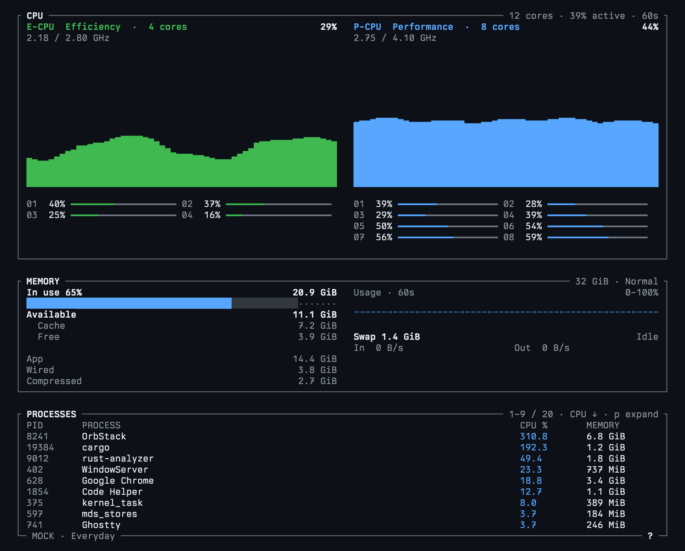

# mactop

A small terminal monitor for Apple Silicon, with native CPU, memory, swap, and process metrics. No sudo required.

Personal project, shared as-is. No support or maintenance commitments.



## Run

Requires macOS on Apple Silicon and Rust.

```sh
cargo run --release
```

Press `?` for controls. Minimum terminal size is 90×25.

Live collection uses private Apple APIs; tested on an M4 Pro.

## License

[MIT](LICENSE).

Inspired by [btop](https://github.com/aristocratos/btop) and [macmon](https://github.com/vladkens/macmon). See [third-party notices](THIRD_PARTY_NOTICES.md) for attribution and implementation references.
